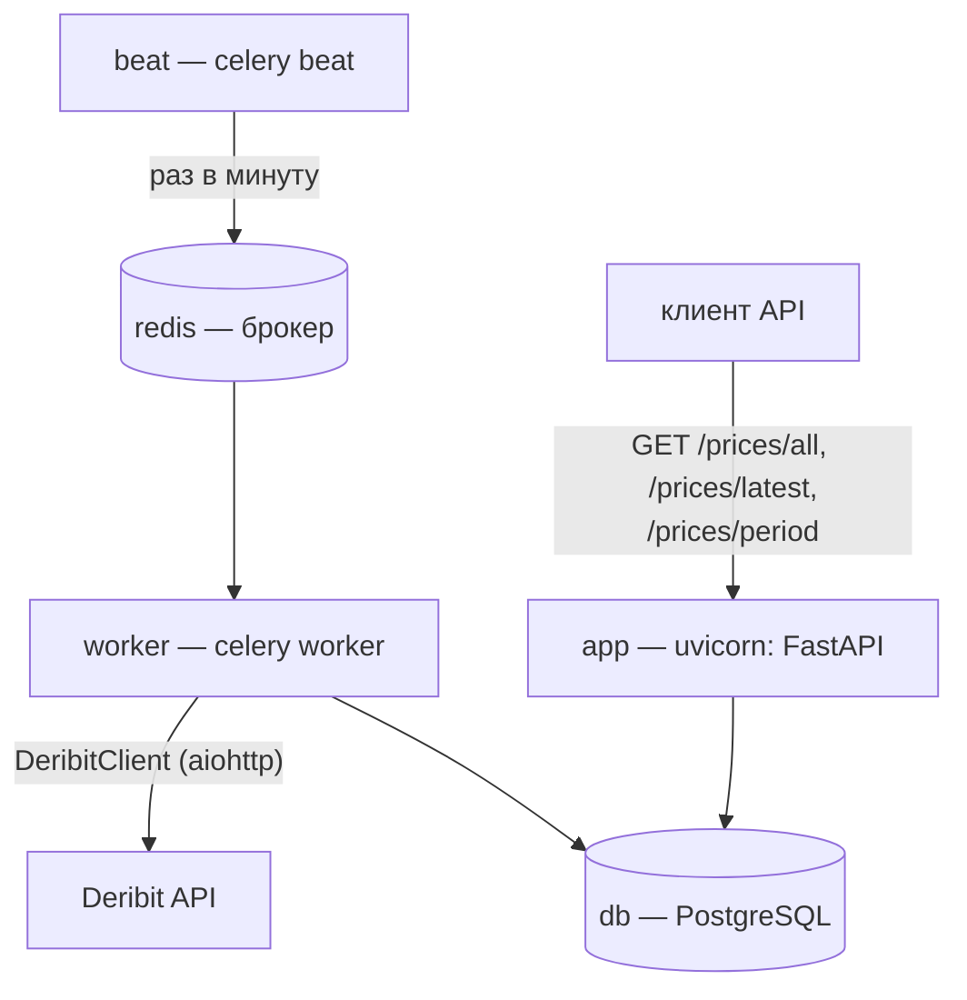

# Deribit price ticker

Собирает index-цены `btc_usd` и `eth_usd` с биржи Deribit раз в минуту и отдаёт историю цен через REST API. Стек: FastAPI, Celery, aiohttp, PostgreSQL.

## Architecture



Один Docker-образ приложения, пять контейнеров. Воркер пишет в базу напрямую через общий слой service/repository — тот же, что читает FastAPI.

## Design decisions

### API

- **Композитный первичный ключ (ticker, timestamp)**. Ticker+timestamp являются и первичным ключем и дополнительным  ограничением для исключения дублей. Заодно и индекс по основным запросам.
- **Ticker**. Приводится к нижнему регистру (`btc_usd`) — так пишет сама биржа и текст задания. Максимальная длина VARCHAR 48 символов.
- **Price**. Для максимального покрытия типовых валют закладываем Decimal с 12 знаками до запятой и 12 знаками после.
- **Timestamp**. Тип BigInteger для исключения проблемы 2038 года.
- **Идентификатор минутного слота**. Пока не реализован, но возможно будет полезен. 
- **Применение миграций Alembic только вручную**. Готовность схемы проверяет healthcheck контейнера (`/ready`). До миграций он честно показывает `unhealthy`.

### Deribit client

- **Независимый запрос к индексу биржи на каждый ticker**. При ошибке одного из запросов остальные продолжают работать штатно.
- **Один timestamp на цикл опроса**. Записи в БД датируются одним timestamp для синхронности.
- **Воркер пишет в БД напрямую, минуя HTTP**. Сбор цен не зависит от доступности сервиса API. При этом запись и чтение идут через единый слой бизнес-логики.
- **Celery beat, Celery worker, Redis как брокер**. — три независимых контейнера, для разделения нагрузки.

## Running (Docker)

```bash
cp .env.example .env    #задать переменные
docker compose up -d    #запускаем контейнеры
docker compose run --rm app alembic upgrade head    #применяем миграции к БД
```

Команда миграций выполняется один раз при первом разворачивании. До неё контейнер `app` показывает `unhealthy`.

Проверка:

```bash
curl http://localhost:3005/api/v1/ready
```

## API

### Методы

- `GET /api/v1/prices/all` | Получение всех сохраненных данных по указанной валюте
- `GET /api/v1/prices/latest` | Получение последней цены валюты
- `GET /api/v1/prices/period` | Получение цены валюты с фильтром по дате

Интерактивная документация Swagger: `http://localhost:3005/docs`, `http://localhost:3005/redoc`.

## Tests

```bash
uv run pytest                    # запуск unit тестов и интеграционных тестов (сами поднимают одноразовый PostgreSQL-контейнер)
uv run pytest src/tests/unit     # только unit тесты
```

## Local development

```bash
docker compose up -d db    # поднять PostgreSQL
uv sync
cd src/price_ticker
alembic upgrade head          # создаст таблицы
uvicorn main:app --port 3005
```
